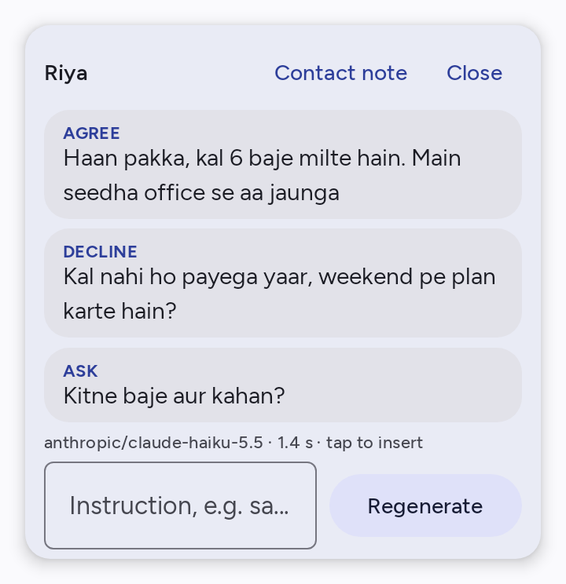
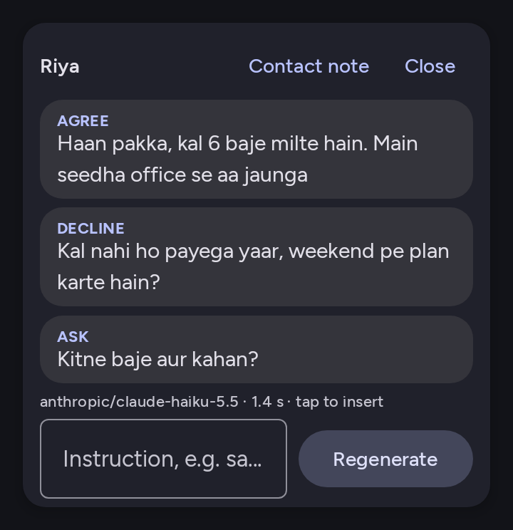

# Screenshot tests

Replyly's screens are rendered on the JVM with [Roborazzi](https://github.com/takahirom/roborazzi)
on the existing Robolectric setup. The PNGs are committed under `app/src/test/screenshots/` and
are the reference: the gate (`scripts/check.sh`, and so CI) fails when a screen no longer matches.

## Write a test

Put the test next to the screen's other tests. The helpers live in
`app/src/test/kotlin/com/paragrudani/replyly/testing/Screenshots.kt`.

```kotlin
@RunWith(RobolectricTestRunner::class)
@GraphicsMode(GraphicsMode.Mode.NATIVE)
@Config(qualifiers = ScreenshotTest.DEVICE)
class PanelScreenshotTest {
    @get:Rule val shots = ScreenshotRule()

    @Test fun cards() = shots.component("panel/cards") { PanelLayout(readyState, "Riya", maxHeight, PanelActions()) }

    @Test fun main() = shots.screen("settings/main") { SettingsScreen(vm, {}, {}, {}) }
}
```

- `shots.screen(name) { }`: the whole screen at the S23 size (360 x 780 dp).
- `shots.component(name, width = …) { }`: the content with 16 dp around it, as tall as it is.
- Each call writes one PNG per variant: `<name>_light.png`, `<name>_dark.png` and
  `<name>_light_font130.png` (font size 130 %). Pass `variants = ShotVariant.LIGHT_DARK` to skip
  the large-font one.
- Shots use the brand colours (dynamic colour off) and reduced motion, so animations are at
  their end state and loops (shimmer) do not run. Show a loading state by passing that state, not
  by catching an animation half-way.
- Name shots `<area>/<state>`: `panel/loading`, `onboarding/welcome`, `settings/usage_limit`.
  One folder per area keeps the parallel PRs out of each other's files.
- Render the stateless layout (`PanelLayout`, `OnboardingContent`) with fixed state. Do not
  render anything that starts an LLM call or reads real storage.
- Classic Views (the floating button): build the View inside an Activity and call
  `view.captureShot(name, variant)`; see `OverlayButtonScreenshotTest`.

## Record

```bash
scripts/record-screenshots.sh                                  # all screenshot tests
scripts/record-screenshots.sh --tests '*PanelScreenshotTest'   # one class
```

It runs `./gradlew recordRoborazziDebug`, rewrites the PNGs and lists what changed. Open the
changed files, check them, and commit them in the same commit as the code that changed the
screen. A new test has no reference yet, so it fails the gate until you record it.

## Verify

`scripts/check.sh` runs `testDebugUnitTest -Proborazzi.test.verify=true`. When a shot differs,
the test fails and Roborazzi writes, for the first differing variant of that test:

- `app/build/outputs/roborazzi/<file>_compare.png`: reference | diff (changes in red) | new;
- `app/build/outputs/roborazzi/<file>_actual.png`: the new rendering.

CI uploads both folders (`app/build/outputs/roborazzi/`, `app/build/reports/roborazzi/`) as the
artifact **replyly-screenshot-diffs** when the check job fails. To see diffs for every shot
without failing, run `./gradlew compareRoborazziDebug` and open
`app/build/reports/roborazzi/debug/index.html`.

## View

The PNGs are plain files: open them in the IDE or the T3 file viewer. On GitHub, browse
`app/src/test/screenshots/` on the branch.

## Put screenshots in a PR body

Link the committed file at the PR's head commit, so the image never changes after review:

```markdown
| Light | Dark |
|---|---|
|  |  |
```

`<sha>` is the full head SHA (`git rev-parse HEAD` after pushing). `?raw=true` makes GitHub serve
the image itself. Show the main state of each screen you changed in light and dark; add the
font-130 shot when the change affects text layout.

## Stability

Screenshots only help if the same code renders the same pixels on every machine. What is pinned:

| What | How |
|---|---|
| Renderer | `@GraphicsMode(GraphicsMode.Mode.NATIVE)` on every screenshot class (Robolectric's real Skia renderer). Robolectric 4.18.1 and its android-all jar are pinned in `gradle/libs.versions.toml`. |
| Android version | `sdk=36` in `app/src/test/resources/robolectric.properties`. |
| Device, density, locale | `ScreenshotTest.DEVICE` = `en-rUS-w360dp-h780dp-xhdpi`. |
| Fonts | Figtree is bundled in `res/font`, so app text never uses a host or system font. Fallback glyphs (✓, →, emoji, Devanagari) come from the fonts inside the pinned android-all jar, not from the host OS. |
| Theme | `dynamicColor = false`, fixed `darkTheme`, `reducedMotion = true` in `ScreenshotRule`. |
| Compare | `SimpleImageComparator(maxDistance = 0.007)`: a pixel counts as changed when its colour moves by more than about 2/255 per channel. `ThresholdValidator(0)`: any changed pixel fails. A 0.1 % threshold was tried first and let a one-letter text change pass. |

Local (this VM) and CI both run Linux x86_64 with JDK 21, so they render alike. If CI ever
reports differences that you cannot see in the `_compare.png` (only a faint grey diff, spread
evenly): do not re-record from CI output. Raise `maxDistance` a little (0.01), note the reason
here, and keep the threshold at 0. macOS or ARM hosts may render text antialiasing differently;
record only on Linux x86_64 (the VM or CI).
